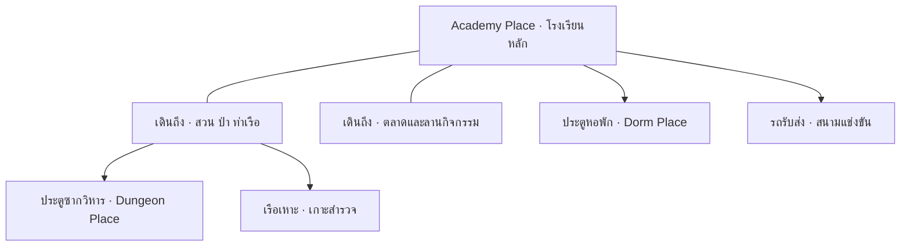

# S04 — ออกแบบสัดส่วนพื้นที่

แหล่งข้อมูลย้อนหลัง ไม่ใช่คำสั่งให้ดำเนินงานในปัจจุบัน ข้อเสนอของผู้ช่วยไม่เท่ากับการอนุมัติของผู้ใช้

Chat ID: `6ae4c0d4-a968-83ec-a99e-291f741e64f2`

## รอบสนทนา 227d5704-7dbf-4ca2-ab16-b9cad839f389

### ผู้ใช้

ลองออกแบบสัดส่วนแต่ละพื้นที่ให้ดูหน่อยจะจุดไหนความใหญ่หรือการวาร์ป

### ผู้ช่วย — ข้อเสนอ/รายงานในเวลานั้น

ผมเสนอให้ **Mythic Academy เป็นโรงเรียนขนาดใหญ่ที่เดินสำรวจต่อเนื่องได้ ส่วนหอพัก ดันเจียน และเกาะไกลใช้วาร์ปแยกพื้นที่** ครับ จุดสำคัญคือมองแล้วอลังการ แต่เส้นทางที่ผู้เล่นต้องใช้ประจำต้องสั้น

ตัวเลขด้านล่างเป็น **ขนาดตั้งต้นสำหรับทำแผนที่ทดลองใน Roblox Studio** ยังต้องปรับจากการลองเดิน บิน และเล่นบนมือถือจริง

**1. ภาพรวมโลกและจุดวาร์ป**

ให้ Academy เป็นศูนย์กลาง ผู้เล่นมองเห็นสถานที่สำคัญก่อน แล้วค่อยปลดล็อกเส้นทางไปพื้นที่อื่น

**แยกการวาร์ปเป็นสองประเภท**

| ประเภท | ใช้เมื่อ | ตัวอย่าง |
|---|---|---|
| วาร์ปภายใน Place เดียวกัน | ย้ายระหว่างจุดที่เคยสำรวจแล้ว | ลานกลาง → เรือนกระจก |
| วาร์ปข้าม Place | เข้าแผนที่ที่มีขนาดใหญ่หรือมีรอบเล่นแยก | โรงเรียน → ดันเจียนของปาร์ตี้ |

ห้องเรียนทั่วไปไม่ควรโหลดแผนที่ใหม่ทุกครั้ง ส่วนห้องฝึกที่เป็นสนามขนาดใหญ่ค่อยแยกเป็นกิจกรรมเฉพาะ

---

**2. สัดส่วน Academy Place**

เสนอพื้นที่หลักประมาณ **1,600 × 1,600 studs** โดยวางเขตใช้งานประจำไว้ตรงกลางประมาณ **700 × 700 studs**

พื้นที่ส่วนที่เหลือใช้สร้างระยะห่าง วิว ป่า หน้าผา และเส้นทางค้นพบ เพื่อให้โรงเรียนดูใหญ่โดยไม่บังคับเดินไกลทุกคาบ

| พื้นที่ | สัดส่วนพื้นดินโดยประมาณ | ขนาดขอบเขตตัวอย่าง | ลักษณะ |
|---|---:|---:|---|
| อาคารเรียนและหอสมุด | 22% | 700 × 800 studs | อาคารหลายหลัง ลานย่อย ทางเชื่อม |
| ลานกลางและทางเข้าหลัก | 10% | 500 × 500 studs | จุดเกิด นัดพบ ประกาศกิจกรรม |
| สวนและเรือนกระจก | 14% | 600 × 600 studs | เรียนพืชเวทมนตร์ เลี้ยงสัตว์ สำรวจ |
| ป่าและซากโบราณ | 20% | 800 × 640 studs | ปริศนา ทางลับ ประตูดันเจียน |
| ทะเลสาบและท่าเรือเหาะ | 12% | 600 × 500 studs | วิว กิจกรรม และการเดินทาง |
| ตลาดและลานสังคม | 8% | 400 × 500 studs | เสื้อผ้า ร้านค้า การแสดง |
| สนามฝึกกลางแจ้ง | 8% | 400 × 500 studs | ฝึกเวท ทดลองการต่อสู้ |
| ทางเชื่อมและพื้นที่กันชน | 6% | กระจายทั่วแผนที่ | สะพาน ทางลาด จุดพัก |

*สัดส่วนนี้เป็นกรอบแบ่งพื้นดิน ไม่รวมพื้นที่แต่ละชั้นของอาคาร และขอบเขตแต่ละโซนไม่จำเป็นต้องเป็นสี่เหลี่ยมจริง*

**ตำแหน่งที่เสนอ**

- **กลางแผนที่:** ลานกลาง มีอาคารเรียนล้อมบางส่วน เห็นหอคอยหลักชัดเจน
- **เหนือ:** หอสมุด หอดูดาว และห้องเรียนระดับสูง ใช้ความสูงสร้างความอลังการ
- **ตะวันออก:** สวน เรือนกระจก และป่า ค่อย ๆ เปลี่ยนบรรยากาศจากปลอดภัยเป็นลึกลับ
- **ตะวันตก:** ตลาด ลานสังคม และทางเข้าหอพัก รวมกิจกรรมพักผ่อนไว้ใกล้กัน
- **ใต้:** ประตูโรงเรียน ทะเลสาบ และท่าเรือเหาะ เป็นจุดเปิดตัวโลก
- **ขอบป่าด้านตะวันออกเฉียงเหนือ:** ซากวิหารและประตูดันเจียน มีระยะให้รู้สึกว่าออกไปผจญภัย

ไม่ควรเปิดประตูทุกโซนตรงลานกลางทั้งหมด เพราะจะทำให้โลกดูเหมือนห้องรอเข้าเกม ให้เห็นปลายทางบางแห่งจากระยะไกลและมีเส้นทางเดินจริงด้วย

---

**3. จุดไหนควรใหญ่ และจุดไหนควรกระชับ**

| สถานที่ | ขนาดเสนอ | เหตุผล |
|---|---:|---|
| ลานกลางที่ใช้งานจริง | 220 × 220 studs | พบเพื่อนง่าย เห็นกิจกรรมชัด |
| โถงใหญ่ | 160 × 220 studs | รองรับพิธีและรวมตัว ใช้เพดานสูงเพิ่มความยิ่งใหญ่ |
| ห้องเรียนทั่วไป | 70 × 90 studs | ผู้เล่นมองเห็นครูและอุปกรณ์ทั่วห้อง |
| ห้องเรียนภาคปฏิบัติ | 110 × 140 studs | มีหลายสถานีให้ลงมือทำ |
| หอสมุด | 180 × 220 studs, 3 ชั้น | มีชั้นลอยและทางลับ แต่จุดยืมหนังสืออยู่ใกล้ทางเข้า |
| เรือนกระจกหนึ่งหลัง | 100 × 150 studs | แยกชนิดพืชและกิจกรรมได้ |
| สนามฝึก | 240 × 300 studs | มีระยะหลบและทดลองเวท |
| ร้านทั่วไป | 35 × 50 studs | เข้าซื้อและลองของได้รวดเร็ว |
| ห้องลับ | 35 × 50 ถึง 90 × 120 studs | ขนาดสัมพันธ์กับปริศนา |
| ทางเดินหลัก | กว้าง 24–36 studs | รองรับผู้เล่นสวนกันและสัตว์เลี้ยง |
| ทางเดินรอง | กว้าง 14–20 studs | ให้บรรยากาศใกล้ชิดและต่างจากโถงหลัก |

**ความยิ่งใหญ่ควรมาจากความสูง รูปร่างอาคาร วิว และระยะมองเห็นด้วย** เช่น หอคอยสูง 250–350 studs อาจมีเพียงไม่กี่ชั้นที่ใช้งานจริง เชื่อมด้วยลิฟต์เวทมนตร์ ไม่จำเป็นต้องให้ผู้เล่นปีนบันไดทุกชั้น

---

**4. การเดินทางต้องใช้เวลาประมาณเท่าไร**

สำหรับการประเมินเบื้องต้น ถ้าตั้งความเร็วเดิน **16 studs/วินาที** ทางตรง 480 studs จะใช้เวลา 30 วินาที แต่เวลาเล่นจริงจะเพิ่มจากทางเลี้ยว บันได และสิ่งที่ผู้เล่นหยุดดู

| เส้นทาง | เป้าหมายเวลาเดินจริง | แนวทาง |
|---|---:|---|
| จุดเกิด → จุดเริ่มบทเรียนแรก | 15–25 วินาที | เห็นทางชัด ไม่มีหลายชั้น |
| ห้องเรียน → ห้องเรียนที่ใช้ต่อกัน | 15–35 วินาที | รวมอยู่ในกลุ่มอาคารเดียวกัน |
| ลานกลาง → ตลาด/ประตูหอพัก | 20–40 วินาที | เป็นเส้นทางใช้บ่อย |
| ลานกลาง → สวน/สนามฝึก | 35–60 วินาที | มีของให้ดูระหว่างทาง |
| ลานกลาง → ท่าเรือเหาะ | 45–75 วินาที | มีทางลัดเมื่อค้นพบแล้ว |
| ลานกลาง → ประตูดันเจียน | 60–90 วินาทีครั้งแรก | ครั้งต่อไปใช้จุดวาร์ป |
| ออกสำรวจป่าเต็มเส้นทาง | 3–5 นาที | มีปริศนาและรางวัล ไม่ใช่เดินเปล่า |

หากเส้นทางไปเรียนเกินเป้าหมาย ให้ขยับห้องเข้าหากันก่อนเพิ่มจุดวาร์ป เพราะการต้องวาร์ปทุกคาบจะลดความรู้สึกว่าอยู่ในโรงเรียนเดียวกัน

---

**5. จุดวาร์ปในโรงเรียน**

เริ่มด้วย **5 จุด** ก็เพียงพอ

| จุด | ตำแหน่ง | เงื่อนไข |
|---|---|---|
| หินนำทางกลาง | ริมลานกลาง | ใช้ได้ตั้งแต่เริ่ม |
| หินพฤกษา | ทางเข้าสวน | เดินไปเปิดครั้งแรก |
| หินฝึกเวท | ข้างสนามฝึก | เปิดหลังบทเรียนเบื้องต้น |
| หินท่าเรือ | ลานก่อนขึ้นเรือ | เปิดเมื่อสำรวจถึง |
| หินซากวิหาร | พื้นที่ปลอดภัยหน้าดันเจียน | เปิดเมื่อจบภารกิจแนะนำ |

ข้อกำหนดการออกแบบ:

- มีตัวเลือก **กลับลานกลาง** ฟรี หลังผ่านช่วงแนะนำเกม
- จุดมาถึงอยู่ริมลาน ไม่ทับประตูหรือจุดรับภารกิจ
- ก่อนวาร์ปแสดงชื่อและภาพปลายทาง
- ไม่วางจุดวาร์ปข้ามปริศนาที่ยังไม่แก้
- ไม่ขายสิทธิ์เดินทางพื้นฐานให้เฉพาะคนจ่ายเงิน ขายรูปลักษณ์ประตูหรือเอฟเฟกต์ได้

---

**6. ขนาดของ Place ที่แยกออกไป**

| Place | ขนาดตั้งต้น | วิธีเข้า | การจัดพื้นที่ |
|---|---:|---|---|
| **Dorm** | 500 × 500 studs, 3–4 ชั้น | ประตูหอพักใน Academy | โถงรวม 30%, ห้องพัก 40%, พื้นที่กิจกรรม 20%, ทางเชื่อม 10% |
| **Dungeon** | ขอบเขตประมาณ 600 × 900 studs ต่อรอบ | ประตูซากวิหาร | 6–8 ห้องหลัก พร้อมทางแยกและห้องลับ |
| **เกาะสำรวจเล็ก** | 600 × 600 studs | เรือเหาะ | จุดขึ้นฝั่ง หมู่ซาก ปริศนาหลัก และจุดชมวิว |
| **เกาะสำรวจใหญ่** | 1,000 × 1,000 studs | เรือเหาะหลังปลดล็อก | หลายภูมิประเทศ มีจุดพักและทางลัด |
| **สนามแข่งขัน** | 400 × 600 studs | จุดรวมทีม/รถรับส่ง | ลานรอ สนาม และพื้นที่ผู้ชม |

**หอพัก:** ประตูอาคารใน Academy พาเข้าหอพักที่เลือกไว้ ห้องส่วนตัวเริ่มประมาณ **60 × 70 studs** แล้วเพิ่มรูปแบบผังได้ภายหลัง ห้องของเพื่อนต้องมีระบบเยี่ยมและสิทธิ์เข้าห้องชัดเจน

**ดันเจียน:** รวมทีมหน้าประตูแล้วเข้าแผนที่ของปาร์ตี้ เดินต่อเนื่องระหว่างห้องภายในรอบเดียว จบแล้วกลับหน้าประตูเดิม ไม่ต้องวาร์ปโหลดใหม่ทุกห้อง

**เกาะลับ:** ครั้งแรกใช้เรือเหาะหรือเส้นทางค้นพบเพื่อสร้างความประทับใจ หลังค้นพบจึงเปิดเดินทางเร็วกลับเกาะได้

---

**7. ขนาดที่ควรสร้างจริงในเวอร์ชันแรก**

ผมแนะนำให้กำหนดกรอบโลกไว้ที่ 1,600 × 1,600 studs แต่ **เริ่มทำพื้นที่เล่นให้สมบูรณ์ประมาณ 800 × 800 studs ก่อน** ประกอบด้วย:

- ลานกลางและโถงใหญ่
- ห้องเรียน 3 ห้องที่เล่นได้จริง
- หอสมุดส่วนแรกและห้องลับ 1 ห้อง
- สวนและเรือนกระจก 1 หลัง
- ตลาดขนาดเล็กและประตูหอพัก
- เส้นทางป่าสั้น ๆ ไปประตูดันเจียน
- หอพัก 1 แบบ และดันเจียน 1 เส้นทาง
- จุดวาร์ปภายในเพียง 3 จุด: ลานกลาง สวน และหน้าดันเจียน

รอบนอกใช้วิวทะเลสาบ หอคอย เกาะลอย และอาคารที่ยังไม่เปิดสร้างภาพของโรงเรียนเต็มขนาด โดยระบุพื้นที่ที่ยังเข้าไม่ได้ให้ชัดเจน

**หลักตัดสินแผนที่นี้คือ: ไปเรียนสะดวก นัดเจอเพื่อนง่าย และเมื่อเลือกออกสำรวจจึงค่อยรู้สึกว่าโลกกว้างครับ**
