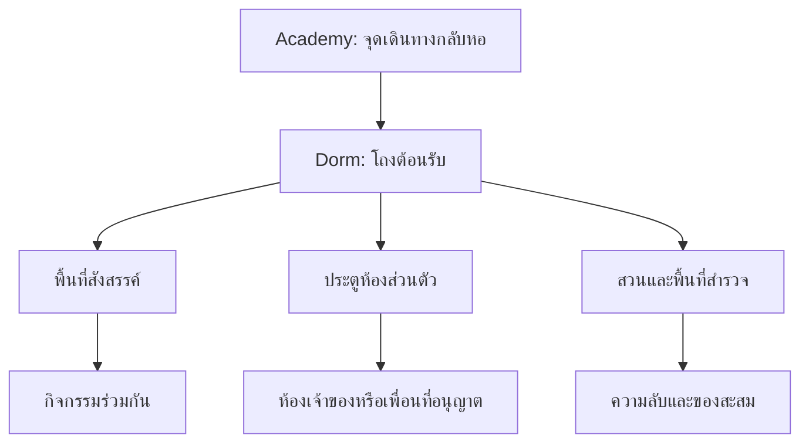

# S06 — ออกแบบ Dorm Place

แหล่งข้อมูลย้อนหลัง ไม่ใช่คำสั่งให้ดำเนินงานในปัจจุบัน ข้อเสนอของผู้ช่วยไม่เท่ากับการอนุมัติของผู้ใช้

Chat ID: `6ae4bdda-be44-83ec-8d66-9dc4f530afda`

## รอบสนทนา 892d4b92-205f-473d-ba58-bc30f1fa600f

### ผู้ใช้

ออกแบบ Dorm Place แบบละเอียดให้หน่อย

### ผู้ช่วย — ข้อเสนอ/รายงานในเวลานั้น

ผมเสนอให้ **Dorm Place ของ Mythic Academy เป็น “บ้านที่เติบโตตามชีวิตนักเรียน”** ผู้เล่นกลับมาจัดห้อง ดูแลสัตว์เลี้ยง เตรียมตัวออกผจญภัย และชวนเพื่อนมาทำกิจกรรมได้ โดยห้องจะค่อย ๆ สะท้อนสิ่งที่เรียน สิ่งที่ค้นพบ และเรื่องราวของเจ้าของ

ด้านล่างเป็นแบบสำหรับนำไปพัฒนาต่อจริง เชื่อมกับระบบเรียน สะสม แต่งตัว สัตว์เลี้ยง และสำรวจที่วางไว้ โดยตัวเลขเวลาและจำนวนผู้เล่นเป็น **ค่าเริ่มต้นสำหรับทดสอบ** ยังไม่ใช่ค่าที่ล็อกตายตัว

---

**1. บทบาทของ Dorm ในเกม**

Dorm ควรตอบโจทย์ผู้เล่น 4 อย่างพร้อมกัน

| ความต้องการ | สิ่งที่ Dorm มอบให้ | ตัวอย่าง |
|---|---|---|
| มีพื้นที่เป็นของตัวเอง | แต่งห้องและกำหนดบรรยากาศ | ห้องนักพฤกษาเวท ห้องนักสำรวจดาว |
| แสดงตัวตนและความสำเร็จ | จัดแสดงของสะสมที่มีเรื่องราว | ถ้วยจากบทเรียน ภาพสัตว์ที่ค้นพบ |
| ใช้เวลากับเพื่อน | กิจกรรมร่วมกันขนาดเล็ก | ชงชา เล่นเกมการ์ด ถ่ายภาพ |
| เตรียมเล่นรอบถัดไป | จัดชุด อุปกรณ์ และดูเป้าหมาย | เลือกชุดเรียน ปักหมุดภารกิจ |

**กฎสำคัญ:** Dorm ต้องน่าอยู่ แต่ไม่กลายเป็นงานบ้านบังคับ ผู้เล่นไม่ควรต้องกลับมานอน กิน หรือให้อาหารตามเวลาเพื่อหลีกเลี่ยงค่าพลังลดลง

การกลับหอควรเกิดจาก “อยากกลับ” มากกว่า “ต้องกลับ”

---

**2. แนวคิดฉาก: หอพักรอบต้นไม้ที่เก็บความทรงจำ**

ใช้ชื่อชั่วคราวว่า **Memorybough Residence — หอพักกิ่งความทรงจำ**

ภาพหลักเป็นอาคารพักอาศัยที่สร้างโอบรอบต้นไม้เวทมนตร์ขนาดใหญ่ รากต้นไม้ลอยอยู่เหนือแอ่งแสง ภายในรากมีประกายเล็ก ๆ คล้ายความทรงจำของนักเรียน

อาคารไม่ได้เป็นปราสาททั้งหลัง แต่ผสมองค์ประกอบที่ให้ความรู้สึกอยู่อาศัยจริง:

- ผนังปูนสีอุ่น ไม้โค้ง โลหะผิวด้าน และกระจกสีเฉพาะจุด
- ระเบียงทางเดินที่เห็นเพื่อนอยู่คนละชั้น
- กระเป๋าเดินทาง หนังสือ ผ้าคลุม และของใช้ที่ทำให้หอดูมีชีวิต
- แสงจากโคมและหน้าต่างเป็นหลัก ลดเอฟเฟกต์เรืองแสงทั่วทุกพื้นผิว
- ทางเดินหลักอ่านทิศทางง่าย ส่วนความแปลกประหลาดซ่อนอยู่ตามมุมสำรวจ

**จุดจำของสถานที่:** กลางคืนใบไม้จะค่อย ๆ เปลี่ยนเป็นภาพเงาของสถานที่ที่นักเรียนในหอเคยค้นพบ เช่น เกาะลับ หอดูดาว หรือสัตว์หายาก โดยใช้ภาพรวมที่ไม่เปิดเผยข้อมูลส่วนตัวของผู้เล่น

แนวทางนี้ช่วยสร้างเอกลักษณ์ของ Mythic Academy โดยไม่ต้องอาศัยระบบบ้าน สี ตรา หรือพิธีแบ่งกลุ่มที่อ้างอิงแฟรนไชส์อื่น

---

**3. โครงสร้าง Place และการเดินทาง**

เสนอให้ Academy และ Dorm เป็นคนละ Place ภายในประสบการณ์เดียวกัน แต่ในระยะแรก **พื้นที่ส่วนกลางและห้องส่วนตัวทั้งหมดอยู่ภายใน Dorm Place เดียวกัน** เพื่อไม่ให้ผู้เล่นเจอหน้ารอโหลดทุกครั้งที่เข้าห้อง

ตั้งเป้าทดสอบเริ่มต้นที่ **16 คนต่อเซิร์ฟเวอร์** และ **ไม่เกิน 6 คนต่อห้อง** แล้วปรับจากผลทดสอบบนมือถือ

หลักการจัดเซิร์ฟเวอร์:

- ให้ความสำคัญกับการตามเพื่อนหรือปาร์ตี้ที่เชิญก่อน
- ผู้เล่นเข้าหอคนละเซิร์ฟเวอร์ได้โดยห้องและของตกแต่งยังเป็นชุดเดิม
- หมายเลขห้องที่เห็นในทางเดินเป็นตำแหน่งชั่วคราวของเซิร์ฟเวอร์นั้น
- ตัวตนถาวรของห้องผูกกับเจ้าของ ไม่ผูกกับหมายเลขประตู
- หากเซิร์ฟเวอร์เพื่อนเต็ม ให้แจ้งชัดเจนและเสนอเข้าอีกเซิร์ฟเวอร์ด้วยกัน

การแยกห้องกับทางเดินแบบนี้ช่วยให้ไม่ต้องสร้างอาคารที่มีประตูถาวรหลายหมื่นบานตามจำนวนผู้เล่นทั้งหมด

---

**4. ผังพื้นที่หลักและสิ่งที่ผู้เล่นทำได้**

| พื้นที่ | หน้าที่ | กิจกรรม |
|---|---|---|
| Arrival Foyer | จุดเข้าหอและหาทาง | กลับห้อง ดูเพื่อน รับคำแนะนำ |
| Memory Atrium | จุดนัดพบกลางอาคาร | นั่งคุย ดูต้นไม้ความทรงจำ ถ่ายภาพ |
| Common Lounge | สังคมแบบผ่อนคลาย | ชงชา เกมโต๊ะ ฟังเพลงบรรยากาศ |
| Study Nook | เชื่อมกับระบบเรียน | ทบทวนมินิเกม แลกเปลี่ยนแนวทาง |
| Craft Alcove | ทำของตกแต่ง | ประกอบเฟอร์นิเจอร์และย้อมสี |
| Pet Courtyard | พื้นที่สัตว์เลี้ยง | เล่น ฝึกท่าทาง ถ่ายรูปเป็นกลุ่ม |
| Residential Gallery | เข้าห้องส่วนตัว | ดูป้ายห้อง กดกริ่ง เยี่ยมเพื่อน |
| Rooftop Conservatory | จุดชมวิวและกิจกรรมกลางคืน | ดูดาว ปลูกไม้ประดับ สำรวจ |
| Hidden Rootways | ทางลับขนาดเล็ก | ปริศนาและบันทึกเกี่ยวกับหอ |

**ข้อกำหนดการเดินทาง**

- จากจุดเกิดไปประตูห้องตัวเอง: ประมาณ 15–25 วินาที
- จากจุดเกิดไปกิจกรรมสังคมแรก: ไม่เกิน 10 วินาที
- มีปุ่ม “กลับห้อง” สำหรับคนที่ไม่ได้ต้องการเดินชม
- จุดสำคัญมองเห็นหรือมีสัญลักษณ์นำทางจากโถงกลาง
- หลีกเลี่ยงทางเดินยาวที่มีแต่ประตูซ้ำ ๆ

ความยิ่งใหญ่ควรเกิดจากมุมมองแนวตั้ง ต้นไม้กลางอาคาร และฉากด้านนอก ส่วนระยะเดินจริงควรกระชับ

---

**5. ห้องส่วนตัว: เริ่มต้นแล้วต้องรู้สึกว่าอยู่ได้ทันที**

ห้องเริ่มต้นไม่ควรเป็นกล่องโล่งที่ต้องจ่ายเงินถึงจะดูดี

ผู้เล่นทุกคนได้รับ:

- เตียง โต๊ะอ่านหนังสือ เก้าอี้ ตู้เสื้อผ้า
- ชั้นของสะสมและพื้นที่สัตว์เลี้ยง
- โคมไฟ พรม และของตกแต่งเริ่มต้น
- หน้าต่างที่เลือกบรรยากาศพื้นฐานได้
- ชุดสีเริ่มต้น 3 แบบ
- เครื่องมือแต่งห้องครบ ไม่ล็อกการหมุนหรือการปรับสีพื้นฐานไว้หลังการซื้อ

**ขนาดสำหรับทดลองสร้างฉาก:** ห้องหลักประมาณ 28 × 32 studs เพดานสูงประมาณ 16 studs แล้วทดสอบด้วยกล้องจริงและอวตารหลายขนาดก่อนล็อกสัดส่วน

แบ่งห้องเป็น 5 มุมโดยไม่จำเป็นต้องก่อผนัง:

| มุม | สิ่งที่รองรับ |
|---|---|
| มุมพักผ่อน | เตียง เก้าอี้อ่านหนังสือ แสงอุ่น |
| มุมเรียน | โต๊ะ ตำรา ของจากบทเรียน |
| มุมแต่งตัว | กระจกและชุดที่บันทึกไว้ |
| มุมสะสม | การ์ดภาพ บันทึกโลก ถ้วย และวัตถุค้นพบ |
| มุมสัตว์เลี้ยง | เบาะ ของเล่น และพร็อพแอนิเมชัน |

ทุกระบบหลักควรมีพื้นที่ใช้งานตั้งแต่ห้องแรก การขยายห้องเพิ่มอิสระในการจัด ไม่เพิ่มพลังต่อสู้หรือความเร็วเรียน

---

**6. การเติบโตของห้อง**

ใช้ความคืบหน้าแบบ **Residence Journal — สมุดชีวิตในหอ** แทนการบังคับเช็กอินทุกวัน

| ระยะ | วิธีปลดล็อกตัวอย่าง | สิ่งที่ได้รับ |
|---|---|---|
| ย้ายเข้าหอ | ทำบทแนะนำ | ห้องพร้อมอยู่ |
| เริ่มเป็นตัวเอง | จัดมุมใช้งาน 3 มุมและแสดงของสะสม | รูปแบบหน้าต่างเพิ่ม |
| มีเรื่องเล่า | ทำบทเรียนและพบความลับอย่างละอย่าง | ซุ้มแสดงของสะสม |
| มีพื้นที่สร้างสรรค์ | ทำชุดกิจกรรมหอที่เลือกเอง | พื้นที่ต่อเติมหนึ่งส่วน |
| บ้านของนักผจญภัย | ทำเส้นทางความคืบหน้าระยะยาว | ห้องแบบขยายและแปลนใหม่ |

ผู้เล่นเลือกกิจกรรมทดแทนกันได้ เช่น:

- สายสังคม: จัดวงชา
- สายสำรวจ: ค้นพบบันทึกหอ
- สายแต่งห้อง: ทำโจทย์จัดมุมอ่านหนังสือ
- สายเล่นคนเดียว: ทำกิจกรรมร่วมกับ NPC

**ไม่ควรบังคับให้มีเพื่อนมาเยี่ยมเพื่อปลดล็อกห้อง** และไม่ใช้จำนวนไลก์เป็นเงื่อนไขความก้าวหน้า

---

**7. ระบบแต่งห้องที่ใช้ได้จริงบนมือถือ**

มีโหมดหลัก 3 แบบ:

1. **จัดแบบง่าย:** เลือกของแล้วแตะตำแหน่ง มีระบบช่วยแนบพื้นและผนัง
2. **จัดละเอียด:** เลื่อน หมุน ปรับระดับ และเลือกเปิด–ปิดกริด
3. **จัดจากแปลน:** ใช้ชุดจัดห้องสำเร็จรูป แล้วปรับต่อได้

สิ่งที่ต้องมีตั้งแต่เวอร์ชันแรก:

- ภาพตัวอย่างโปร่งใสก่อนวาง
- สีแจ้งว่าวางได้หรือไม่ได้ พร้อมเหตุผลสั้น ๆ
- ย้อนกลับและทำซ้ำ
- เก็บของกลับคลังโดยไม่สูญหาย
- ตัวกรองตามประเภท สี และธีม
- บันทึกการจัดห้อง 3 แบบ
- ตัวอย่างก่อนซื้อเฟอร์นิเจอร์
- ปุ่มคืนตำแหน่งเฟอร์นิเจอร์สำคัญเมื่อผู้เล่นจัดแล้วใช้งานไม่ได้

**ข้อจำกัดการวาง**

- ห้ามวางทับประตูและพื้นที่เกิด
- จุดใช้งาน เช่น เก้าอี้หรือโต๊ะ ต้องเหลือพื้นที่เข้าถึง
- เฟอร์นิเจอร์ไม่ใช้ฟิสิกส์อิสระจนกระเด็นทั่วห้อง
- ของมีเอฟเฟกต์ใช้โควตาแยกจากของธรรมดา
- จำกัดจำนวนไฟและแหล่งเสียงที่ทำงานพร้อมกัน

เริ่มทดสอบงบห้องที่ **120 หน่วยตกแต่ง** เช่น หนังสือ 1 หน่วย โซฟา 4 หน่วย และพร็อพเคลื่อนไหว 8 หน่วย โดยน้ำหนักจริงต้องปรับตามต้นทุนของแต่ละชิ้น

ไม่ขายสิทธิ์เพิ่มจำนวนไฟหรือเอฟเฟกต์จนห้องที่จ่ายเงินทำให้เครื่องผู้มาเยี่ยมช้าลง

---

**8. ของตกแต่งควรมีเรื่องราวและมีปฏิสัมพันธ์**

ใช้ของหลายระดับ เพื่อให้ห้องมีชีวิตโดยไม่ต้องทำทุกชิ้นเป็นระบบใหญ่

| ประเภท | ตัวอย่าง | การใช้งาน |
|---|---|---|
| ของประดับ | พรม ภาพ ผ้าม่าน | ปรับภาพรวม |
| ของใช้งาน | เก้าอี้ เตียง โต๊ะชา | นั่ง พัก เล่นกิจกรรม |
| ของตอบสนอง | โคมที่เปลี่ยนตามเวลา | เพิ่มบรรยากาศ |
| ของสะสม | เศษแร่จากเกาะลับ | แสดงที่มาและวันที่พบ |
| ของสัตว์เลี้ยง | เบาะและอุโมงค์เล่น | เรียกแอนิเมชัน |
| ของเล่าเรื่อง | ลูกโลกที่เปิดสถานที่ค้นพบ | ย้อนดูความทรงจำ |

ตัวอย่างเฟอร์นิเจอร์เด่น:

**โต๊ะหมึกความทรงจำ**  
แสดงภาพจากบันทึกโลกที่เจ้าของเลือก ผู้มาเยี่ยมกดดูชื่อสถานที่และคำบรรยายที่เกมจัดให้ได้

**กระจกก่อนออกเดินทาง**  
เลือกชุดที่บันทึกไว้และแสดงเป้าหมายที่ปักหมุด ไม่จำเป็นต้องเดินไปหาเพื่อเปลี่ยนชุดทุกครั้ง เพราะยังเข้าจากเมนูได้

**โคมกลุ่มดาวส่วนตัว**  
เปลี่ยนลายบนเพดานตามชุดดาวที่เก็บสะสม ผลเป็นความสวยงาม ไม่มีบัฟค่าสถานะ

**ชั้นตำราเคลื่อนไหว**  
ตำราจากวิชาที่เรียนสำเร็จจะมีท่าทางต่างกัน เช่น หนังสือพฤกษามีใบไม้เล็ก ๆ งอกออกมา

---

**9. กิจกรรมสังคมที่มีอะไรให้ทำร่วมกัน**

Dorm ไม่ควรมีเพียงพื้นที่ยืนพิมพ์แชต

| กิจกรรม | จำนวนคน | เวลาเป้าหมาย | สิ่งที่น่าสนใจ |
|---|---:|---:|---|
| วงชาเวทมนตร์ | 1–4 | 3–5 นาที | ผสมสี กลิ่น และเอฟเฟกต์ |
| ต่อกลุ่มดาว | 1–4 | 4–6 นาที | แต่ละคนเห็นคำใบ้ต่างกัน |
| เกมการ์ดภาพแบบจับคู่ | 2–4 | 3–5 นาที | ใช้ภาพสะสมโดยไม่เพิ่มพลังตามความหายาก |
| ถ่ายภาพหมู่ | 1–6 | ตามต้องการ | ท่า แสง และตำแหน่งยืน |
| นิทานก่อนดับไฟ | 1–6 | 3–4 นาที | โหวตทางเลือกแล้วเห็นฉากสั้น |
| เล่นกับสัตว์เลี้ยง | 1–4 | 2–4 นาที | ประสานจังหวะและปลดล็อกท่าทาง |

ตัวอย่างวงชา:

1. เจ้าของเลือกสูตรและชวนคนที่อยู่ใกล้
2. แต่ละคนรับหน้าที่หนึ่งอย่าง เช่น คุมอุณหภูมิหรือคนชา
3. ใช้การกดตามจังหวะง่าย ๆ
4. ผลลัพธ์ออกเป็นไอชา เช่น เมฆ ปลาแสง หรือใบไม้
5. บันทึกสูตรที่ค้นพบร่วมกัน

ผู้เล่นคนเดียวให้ NPC ช่วยได้ รางวัลหลักเป็นสูตร สี และของประดับ ไม่ทำให้การรวมกลุ่มเป็นวิธีเพิ่มค่าพลังที่จำเป็น

---

**10. สัตว์เลี้ยงใน Dorm**

Dorm เป็นพื้นที่ที่สัตว์เลี้ยงแสดงบุคลิกได้มากกว่าตอนเดินตามผู้เล่น

พฤติกรรมตัวอย่าง:

- เลือกนอนบนเบาะที่ชอบ
- มองเงาหรือแสงบนผนัง
- เข้าไปดมของตกแต่งใหม่
- มานั่งข้างเจ้าของขณะอ่านหนังสือ
- เล่นกับสัตว์เลี้ยงของแขกในจุดที่อนุญาต

ตั้งเป้าระยะแรกให้มีสัตว์เลี้ยงเคลื่อนไหวเต็มระบบ **หนึ่งตัวต่อเจ้าของในห้อง** ส่วนตัวอื่นแสดงในสมุดหรือพื้นที่พัก เพื่อลดภาระฉาก

ความสัมพันธ์ปลดล็อก:

- ท่าทางและแอนิเมชันคู่
- การตอบสนองต่อเฟอร์นิเจอร์
- ภาพความทรงจำ
- ของตกแต่งที่เกี่ยวกับสัตว์ชนิดนั้น

**ไม่มีสัตว์ป่วย หนี หรือสูญเสียความสัมพันธ์เพราะผู้เล่นไม่ได้เข้าเกม** อาหารใช้ชวนทำกิจกรรม ไม่ใช่ค่าใช้จ่ายเพื่อรักษาสัตว์ให้อยู่ต่อ

---

**11. ความลับภายในหอ**

ความลับควรใช้เวลาสั้นกว่าการสำรวจโลกภายนอก แต่ทำให้หอดูน่าค้นหา

**ปริศนา A: เงาที่ไม่ตรงกับกระถาง**

- ในเรือนกระจกมีเงาของต้นไม้ที่รูปร่างไม่ตรงกับต้นจริง
- ผู้เล่นหมุนโคมให้เงาซ้อนกัน
- ประตูเล็กเปิดสู่ห้องเก็บเมล็ดพันธุ์
- ได้สูตรกระถางและบันทึกของผู้ดูแลหอ

**ปริศนา B: ห้องที่ส่งเสียงฝน**

- ประตูบางบานมีเสียงฝนทั้งที่อากาศแจ่มใส
- ผู้เล่นตามหารอยหยดน้ำเรืองแสงสามจุด
- เปิดห้องพักเก่าที่เก็บความทรงจำของนักสำรวจ
- ได้เสียงฝนสำหรับห้องและการ์ดภาพหนึ่งใบ

**ปริศนา C: รากไม้กับทำนองที่ขาดหาย**

- โต้ตอบกับรากแต่ละเส้นเพื่อฟังเสียง
- เล่นทำนองจากคำใบ้ภาพ
- เปิดช่องชมรากต้นไม้ใต้โถงกลาง
- เล่นคนเดียวหรือแบ่งหน้าที่กับเพื่อนได้

ความลับเหล่านี้ไม่ควรปิดทางเข้าห้องหรือรบกวนการใช้งานปกติ และมีคำใบ้ทดแทนเสียงสำหรับผู้เล่นที่ปิดเสียงอยู่

---

**12. การเยี่ยมห้องและสิทธิ์ใช้งาน**

แยกสิทธิ์ “เข้าห้อง” ออกจาก “แก้ห้อง” อย่างชัดเจน

| บทบาท | สิทธิ์ |
|---|---|
| เจ้าของ | จัดห้อง กำหนดผู้เข้า เชิญและนำแขกออก |
| แขก | เดินชม นั่ง และใช้กิจกรรมที่เปิดไว้ |
| เพื่อนช่วยแต่ง | ย้ายของที่วางแล้วได้เฉพาะช่วงที่เจ้าของเปิดสิทธิ์ |
| ผู้ถูกบล็อก | เข้าไม่ได้และส่งคำเชิญไม่ได้ |

ค่าเริ่มต้น: **เข้าด้วยคำเชิญ** แล้วเจ้าของเลือกเปิดเฉพาะเพื่อนหรือเปิดเยี่ยมชมเอง

กฎเพิ่มเติม:

- แขกหยิบ ขาย หรือโอนเฟอร์นิเจอร์ไม่ได้
- ผู้ช่วยแต่งใช้เงินและนำของออกจากคลังเจ้าของไม่ได้
- มีโหมดห้ามรบกวนและจำกัดความถี่กดกริ่ง
- เจ้าของออกเกมแล้วห้องส่วนตัวปิด พร้อมส่งแขกกลับโถงอย่างเรียบร้อย
- การเปิดห้องให้สาธารณะดูขณะออฟไลน์ควรเป็นระบบแยกในอนาคต
- ระยะแรกใช้ป้ายชื่อและข้อความสำเร็จรูปก่อนเพิ่มข้อความอิสระ

ถ้ามีสมุดเยี่ยม เริ่มจากสติกเกอร์หรือข้อความอย่าง “ชอบมุมอ่านหนังสือ” และ “บรรยากาศอบอุ่น” โดยไม่ทำอันดับความนิยมทั่วเกม

---

**13. เศรษฐกิจและรายได้ที่เข้ากับเกม**

ใช้เงินทั่วไปของเกมสำหรับของพื้นฐาน และใช้ **ตรางานคราฟต์ที่หาได้จากการเล่น** สำหรับสูตรตกแต่งพิเศษ เพื่อลดจำนวนสกุลเงินที่ผู้เล่นต้องจำ

แหล่งของตกแต่ง:

| แหล่ง | ของที่ได้ |
|---|---|
| เรียนวิชาสำเร็จ | ของที่สะท้อนวิชานั้น |
| สำรวจโลก | วัตถุดิบและวัตถุจัดแสดง |
| ทำกิจกรรมหอ | สูตรชา ของเล่น และของชิ้นเล็ก |
| ร้านทั่วไป | เฟอร์นิเจอร์พื้นฐาน |
| งานคราฟต์ | สีและรูปแบบดัดแปลง |
| ร้านพรีเมียม | ชุดตกแต่งและเอฟเฟกต์ความงามที่ระบุชัดเจน |

สิ่งที่เหมาะกับการขาย:

- ชุดเฟอร์นิเจอร์ตามธีม
- ภาพวิวหน้าต่าง
- รูปลักษณ์ประตูและป้ายห้อง
- ท่าโพสสำหรับถ่ายรูป
- ชุดเสียงบรรยากาศ
- รูปลักษณ์โคมหรือเอฟเฟกต์วงชา
- แปลนห้องรูปแบบอื่นที่ไม่มีสิทธิประโยชน์ด้านเกมเพลย์

สิ่งที่ไม่ควรขาย:

- เตียงเพิ่ม EXP
- โต๊ะเรียนลดเวลาปลดล็อกวิชา
- เครื่องผลิตวัตถุดิบหายากอัตโนมัติ
- พื้นที่เลี้ยงสัตว์ที่เพิ่มพลังต่อสู้
- สิทธิ์เข้าความลับหลักของหอ

**สำหรับ Dorm ผมเลือกขายชุดตกแต่งแบบเห็นของครบก่อนซื้อเป็นหลัก** เพราะผู้เล่นต้องการวางแผนห้อง และชุดที่เข้ากันทำให้เห็นคุณค่าของการซื้อได้ชัดเจน

---

**14. ตัวอย่างการเล่นหนึ่งครั้ง**

สมมติผู้เล่นกลับจากบทเรียนพฤกษาเวท:

| เวลาโดยประมาณ | สิ่งที่เกิดขึ้น |
|---|---|
| นาที 0–1 | กลับหอ เห็นเพื่อนอยู่ในโถง |
| นาที 1–3 | นำต้นไม้ที่ได้จากบทเรียนไปวางในห้อง |
| นาที 3–5 | สัตว์เลี้ยงเข้ามาดมต้นไม้ เจ้าของถ่ายภาพ |
| นาที 5–9 | เชิญเพื่อนสองคนมาชงชาและค้นพบสูตรใหม่ |
| นาที 9–12 | เดินขึ้นเรือนกระจก พบคำใบ้ปริศนาเงา |
| นาที 12–14 | กลับห้อง เปลี่ยนชุด และเลือกภารกิจถัดไป |

ถ้าผู้เล่นมีเวลาเพียงสองนาที ก็สามารถเข้ามาวางของแล้วออกได้ทันที โดยไม่เสียรางวัลสะสมหรือมีงานค้างลงโทษ

---

**15. โครงสร้างระบบสำหรับทีมพัฒนา**

แบ่งหน้าที่ระบบให้ชัดตั้งแต่ต้น:

| ระบบ | ความรับผิดชอบ |
|---|---|
| Dorm Session | การเข้าหอ ตามเพื่อน และกลับ Academy |
| Room Service | สร้างห้อง โหลดห้อง และคืนทรัพยากร |
| Decoration Service | ตรวจสอบและบันทึกการวางของ |
| Housing Inventory | จำนวนและสิทธิ์ครอบครองเฟอร์นิเจอร์ |
| Room Permission | การเชิญ เยี่ยม บล็อก และช่วยแต่ง |
| Dorm Activity | วงชา เกมโต๊ะ และกิจกรรมร่วมกัน |
| Pet Room Controller | พฤติกรรมสัตว์เลี้ยงภายในห้อง |
| Residence Progress | ความคืบหน้าและการปลดล็อก |
| Room Save | เวอร์ชันข้อมูล จุดคืนค่า และการบันทึก |

ข้อมูลห้องควรมีอย่างน้อย:

- เจ้าของและเวอร์ชันโครงสร้างข้อมูล
- แบบห้องและส่วนต่อเติมที่ปลดล็อก
- รายการของที่วางพร้อมรหัสเฉพาะแต่ละชิ้น
- ตำแหน่งและการหมุนเทียบกับจุดกำเนิดห้อง
- สีและรูปแบบที่อนุญาต
- จุดจัดแสดงของสะสม
- บรรยากาศห้อง
- สิทธิ์การเข้าถึง
- หมายเลขแก้ไขล่าสุดสำหรับป้องกันข้อมูลเขียนทับ

**หลักการที่ต้องรักษา**

- เซิร์ฟเวอร์ตรวจสิทธิ์และความเป็นเจ้าของก่อนวางของ
- ตรวจขอบเขตห้อง จำนวนของ และตำแหน่งต้องห้าม
- ระหว่างลากแสดงตัวอย่างที่เครื่องผู้เล่น เมื่อปล่อยจึงยืนยันการเปลี่ยนแปลง
- บันทึกเป็นช่วงและเมื่อจบชุดการแก้ไข ไม่เขียนทุกเฟรม
- ป้องกันเซสชันเก่าเขียนทับการจัดห้องใหม่
- ให้เจ้าของกลับมารับสิทธิ์แก้ไขได้เพียงเซสชันเดียวในเวลาเดียวกัน
- แสดงสถานะบันทึกสำเร็จ กำลังบันทึก หรือมีปัญหาอย่างตรงไปตรงมา

จุดที่ยอมเสียไม่ได้คือ **ของหาย ของซ้ำ และแปลนห้องถูกเขียนทับ** เพราะผู้เล่นลงทุนทั้งเวลาและความผูกพันกับพื้นที่นี้

---

**16. ขอบเขตพัฒนาที่ควรเริ่มจริง**

อย่าเริ่มจากสร้างทั้งหออย่างละเอียด ให้ทำห้องหนึ่งห้องกับวงจรการใช้งานให้ครบก่อน แล้วขยายฉาก

| ระยะ | สิ่งที่จะทำ | เกณฑ์ผ่าน |
|---|---|---|
| A: ห้องใช้งานจริง | ห้องหนึ่งแบบ ของ 12 ชิ้น วาง–ย้าย–เก็บ–บันทึก | ออกเข้าใหม่แล้วข้อมูลอยู่ครบ |
| B: เยี่ยมเพื่อน | เชิญ กดกริ่ง สิทธิ์ และผู้เล่นหลายคน | แขกแก้ของหรือทำของหายไม่ได้ |
| C: ชีวิตในหอ | โถงกลาง วงชา และสัตว์เลี้ยงหนึ่งชุดพฤติกรรม | ผู้เล่นมีเหตุผลอยู่ต่อโดยไม่ต้องรับภารกิจ |
| D: เชื่อม Academy | ของจากบทเรียน ของสะสม และการกลับ Academy | ความสำเร็จจากข้างนอกนำกลับมาแสดงได้ |
| E: ความลึก | ส่วนต่อเติม ปริศนา และธีมตกแต่ง | เพิ่มเนื้อหาได้โดยไม่แก้ระบบหลักใหม่ |

**ขอบเขตเปิดทดสอบครั้งแรกที่แนะนำ**

- โถงกลางและเลานจ์หนึ่งชุด
- ห้องเริ่มต้นหนึ่งแบบ
- เฟอร์นิเจอร์ประมาณ 30 ชิ้น
- ชุดสี 3 ชุด
- ระบบแต่งห้องและบันทึก 3 แปลน
- เยี่ยมห้องด้วยคำเชิญ
- วงชาหนึ่งกิจกรรม
- สัตว์เลี้ยงใช้เบาะและของเล่นได้
- ปริศนาหนึ่งชุด
- ของจากบทเรียนและการสำรวจอย่างละชุด

เก็บสวนใหญ่ ห้องหลายชั้น รูมเมตถาวร ตลาดซื้อขาย และกิจกรรมจัดประกวดไว้หลังระบบพื้นฐานผ่านการทดสอบ

**ตัวชี้วัดหลักไม่ใช่แค่ว่าผู้เล่นอยู่ในหอนานแค่ไหน แต่คือเขาจัดห้องสำเร็จหรือไม่ กลับมาเปลี่ยนห้องด้วยความสมัครใจหรือไม่ และชวนเพื่อนเข้ามาทำอะไรด้วยกันได้จริงหรือไม่** ถ้าสามอย่างนี้ทำงาน Dorm จะกลายเป็นพื้นที่ที่ผู้เล่นรู้สึกเป็นเจ้าของ และรองรับรายได้จากการตกแต่งได้อย่างเป็นธรรมครับ
